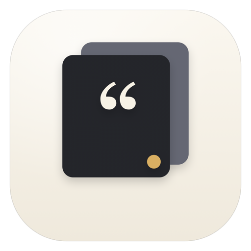
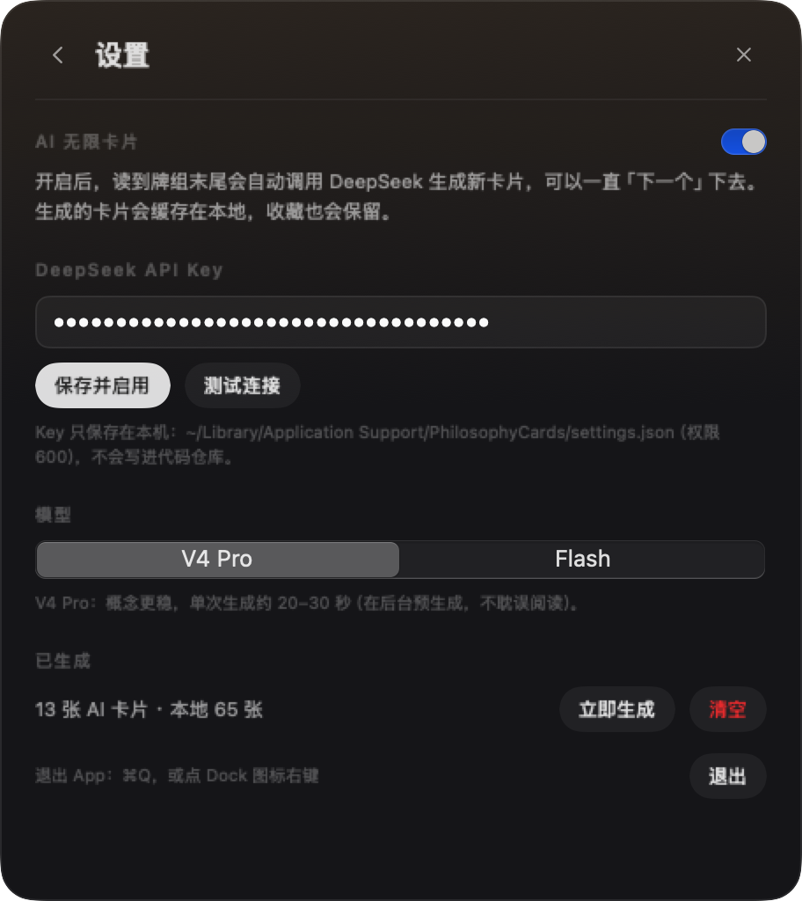

# 哲思卡片 · PhilosophyCards



一个常驻 macOS 菜单栏的极简知识卡片小组件。65 张本地精选，加上用 DeepSeek 源源不断生成的新卡片——每次只给你一个概念：中英文名、一句话定义、一段通俗解释、一个生活里的例子。

按一下 `⌥⌘K` 呼出，读完点「下一个」，可以一直读下去。


<p align="center">&nbsp;&nbsp;</p>

## 功能

- **65 个本地概念**，覆盖哲学、存在主义哲学、社会心理学、人格心理学、教育心理学
- **AI 无限卡片**：读到哪儿，后台就补到哪儿；生成的卡片会先审稿、再查重，然后插进你接下来要读的几张里
- **双模型可选**：V4 Pro（概念更稳）/ Flash（更快、更口语）
- **卡片式浮动面板**：贴在菜单栏图标下方，失焦自动收起，不打断当下的工作
- **收藏**：本地存储，随时查看列表、跳回某张卡片、取消收藏；AI 卡片也可以收藏
- **Dock 图标 + ⌘Q**：这次是真的退出；点 Dock 图标又能把面板叫回来
- **固定在桌面**：点右上角的图钉，面板常驻置顶，不会因为切换 App 而消失
- **断网也不空**：Key 失效、接口超时的时候自动回落到本地牌组
- 深色 / 浅色自动适配；记忆上次读到哪一张、上次收藏了什么、窗口挪到过哪里

## 快捷键

| 操作 | 快捷键 |
| --- | --- |
| 呼出 / 隐藏面板 | `⌥⌘K`（全局） |
| 下一个 / 上一个 | `→` `Space` `N` / `←` `P` |
| 收藏 / 取消收藏 | `F` 或 `⌘D` |
| 打开 / 关闭收藏列表 | `T` 或 `Tab` |
| 收起面板 | `Esc`（在设置/收藏页则先返回卡片） |
| 退出 App | `⌘Q`，或 Dock 图标右键菜单，或设置页底部 |

底栏的 ✦ 图标是 AI 状态：灰=未开启、亮=已开启、闪=正在生成、橙色=离线。点它或右键菜单「AI 设置…」可以进入设置。菜单栏图标：左键开合，右键菜单。

## 运行

```bash
cd PhilosophyCards
./build.sh --run
```

`build.sh` 会直接编译成 `build/哲思卡片.app`（ad-hoc 签名，可在本机运行）。首次启动会自动弹出第一张卡片，菜单栏出现一个引号图标，Dock 里也会出现 App 图标。

右上角的 `×` 和 `Esc` 一样**只是收起面板**（和 Raycast / Spotlight 的浮窗逻辑一致），不是退出。要完全退出用 `⌘Q`、右键 Dock 图标，或设置页最下面的「退出」。点 Dock 图标可以重新把面板叫回来；固定状态下面板会常驻。

## 分享给别人

```bash
./package.sh
# → dist/哲思卡片-macOS-0.2.0.zip（Universal：Apple Silicon + Intel，约 1.2 MB）
```

压缩包里是「哲思卡片.app + 安装说明.txt」。对方：

1. 解压，把 App 拖进「应用程序」；
2. 第一次打开时右键图标 →「打开」放行一次（或者到 系统设置 → 隐私与安全性 → 仍要打开）；
3. 没有 API Key 也能用 65 张本地卡片；点底栏的 **✦ AI 设置** 填自己的 Key，就能开启 AI 无限卡片。

App 里不含任何 Key，也不会带上你的收藏和已生成卡片；对方填的是自己的 Key，存在对方自己的电脑上。

**关于签名**：这是 ad-hoc 签名，没有做 Apple 公证，所以 Gatekeeper 会提示「无法验证开发者」，需要手动放行一次。如果要做到「双击直接打开」的正式分发，需要 Apple Developer Program（99 美元/年）签名 + `notarytool` 公证。

> 如果对方用的是别的 OpenAI 兼容服务（模型名不是 `deepseek-v4-pro` / `deepseek-flash`），需要改 `settings.json` 里的 `baseURL`，或改 `AISettings.availableModels` 里的模型列表。

## AI 卡片是怎么来的

1. 阅读时如果「前方可读的 AI 卡片」不足 6 张，后台就开始生成 6 张（不会打断阅读，也不显示加载）。
2. 生成结果会再走一次**概念审稿**：把生造的、只是描述性短语的、或把理论改写成论文标题的名字剔除。
3. 本地再做一次**查重**：中文名、英文名、编辑距离、互相包含，都会挡掉与已有 65 张重复或近义的概念。
4. 通过的卡片写入 `ai-cards.json`，并插到当前卡片之后 3–8 张的位置——不用读完整个本地牌组就能读到新内容。
5. 失败后 45 秒内不重试，避免连续刷接口；期间继续用本地牌组。

一批（6 张候选 + 一次审稿）大约消耗 2k–3k tokens。如果生成的内容不对，可以在收藏列表里取消收藏，或者直接清空 AI 缓存（设置页底部）。

## 配置

设置入口：底栏 ✦ 图标、右键菜单「AI 设置…」。

- Key 只保存在本机：`~/Library/Application Support/PhilosophyCards/settings.json`（权限 `600`），**没有写进代码仓库**。
- 第一次在别的机器上运行，没有任何 Key，App 会以「纯本地 65 张」模式启动。点底栏 ✦ 打开设置页填入即可；也可以先复制模板再填：
  ```bash
  mkdir -p "$HOME/Library/Application Support/PhilosophyCards"
  cp Support/settings.example.json "$HOME/Library/Application Support/PhilosophyCards/settings.json"
  chmod 600 "$HOME/Library/Application Support/PhilosophyCards/settings.json"
  ```
- 支持用环境变量 `DEEPSEEK_API_KEY` 覆盖（不会写回文件）。
- 也可以用官方 DeepSeek 或其他 OpenAI 兼容接口：改 `settings.json` 里的 `baseURL` 即可。如果对方不认识 `thinking` 参数，客户端会自动去掉再重试一次。
- 生成过的卡片缓存在 `~/Library/Application Support/PhilosophyCards/ai-cards.json`，最多保留 300 张（收藏的优先保留）；id 从 10000 起，和本地 65 张（1–65）不会冲突。

## 构建说明

- **不需要 Xcode**，用 Swift 工具链 + 系统 SDK 直接编译（`swiftc -parse-as-library`）。
- 这台机器的 Command Line Tools 里有一个损坏的 Clang modulemap（`SwiftBridging` 重复定义），会导致任何 `import SwiftUI` 编译失败。因此 `build.sh` 会优先使用独立工具链 `~/Library/Developer/SwiftToolchains/*/usr/bin/swiftc`；也可以用 `SWIFTC=/path/to/swiftc ./build.sh` 指定，或装好 Xcode 后用 `xcodebuild`。
- 如果已有 Xcode，也可以直接 `open Package.swift`（SwiftPM 工程），在 Xcode 里运行。
- 项目如果放在 iCloud 同步的目录（比如桌面），系统会在签名后反复给 `.app` 加 `FinderInfo` 扩展属性，`codesign` 偶尔会因此失败、导致双击打不开。`build.sh` 已经会自动重试并校验签名；如果仍然提示签名失败，把项目移到非 iCloud 目录（如 `~/Developer`）再构建。

## 项目结构

```
PhilosophyCards/
├── Package.swift                      # 给 Xcode / SwiftPM 用的工程定义
├── build.sh                           # 无 Xcode 的构建 + 打包脚本
├── Support/
│   ├── Info.plist                     # 常规 App（有 Dock 图标）、图标声明
│   ├── AppIcon.icns                   # App 图标
│   └── settings.example.json          # API Key 配置模板（空 Key）
├── Sources/PhilosophyCards/
│   ├── App/
│   │   ├── PhilosophyCardsMain.swift  # @main（纯 AppKit，无空白设置窗口）
│   │   ├── AppDelegate.swift          # 生命周期、菜单栏菜单、启动展示
│   │   ├── PanelController.swift      # 浮动面板、定位、键盘
│   │   ├── StatusItemController.swift # 菜单栏图标
│   │   └── GlobalHotKey.swift         # Carbon 全局快捷键（无需辅助功能权限）
│   ├── Model/
│   │   ├── Concept.swift              # 数据模型 + 领域配色
│   │   ├── ConceptLibrary.swift       # 本地 JSON 读取
│   │   ├── AppModel.swift             # 牌组、收藏、路由、AI 预生成调度
│   │   ├── AISettings.swift           # 设置文件 + AI 卡片缓存
│   │   ├── DeepSeekClient.swift       # 生成 + 审稿
│   │   └── AICardValidator.swift      # 字段校验、查重
│   ├── UI/
│   │   ├── RootView.swift             # 面板背景与页面切换
│   │   ├── CardView.swift             # 卡片
│   │   ├── FavoritesView.swift        # 收藏列表
│   │   ├── SettingsView.swift         # AI 设置
│   │   ├── Components.swift           # 小组件
│   │   ├── Theme.swift                # 尺寸、颜色
│   │   └── SnapshotRenderer.swift     # 开发用：把界面渲染成 PNG
│   └── Resources/concepts.json        # 本地知识库（65 条）
└── docs/                              # 截图
```

## 知识库

数据结构（`Resources/concepts.json`）：

```json
{
  "id": 12,
  "name": "自我异化",
  "en": "Self-Alienation",
  "definition": "与自己的感受、需求和欲望失去连接，像旁观者一样观察自己而不是体验自己。",
  "explanation": "……通俗解释，两百字以内……",
  "example": "……一个具体的例子或场景……",
  "field": "存在主义哲学"
}
```

- `id` 必须唯一；`field` 只能是：`哲学`、`存在主义哲学`、`社会心理学`、`人格心理学`、`教育心理学`（新增领域时同时改 `Category` 枚举）。
- 想改内容直接编辑 JSON 后重新 `./build.sh` 即可。
- 这个知识库参考了 `seeds.json` 里你关注的议题：**那 15 个概念全部保留**，解释和例子改写成了通用的第二人称，去掉了原文中涉及私人对话的部分，并从同一批主题扩展到了 65 个。

## 一些设计取舍

- **固定 456 × 512 的卡片**：按最长的一条内容校准过，翻卡时高度不跳动；AI 生成的解释偏长时，正文区域会在必要时滚动，不会截断。
- **面板贴在菜单栏图标下方，失焦即收起**：这是 Raycast / Spotlight 的交互；需要「一直看着」时点图钉固定。
- **全局快捷键用 Carbon `RegisterEventHotKey`**：不需要用户去「辅助功能」里授权，装上就能用。
- **AI 是「补货」不是「现做」**：每次后台预生成 4 张，你读到末尾前它已经在队列里了，所以感觉不到等待。
- **收藏存 `UserDefaults`，AI 卡片存独立 JSON**：数据量小、读写简单；换 CloudKit 时只需要改 `AppModel` 和两个 store。

## 已知限制

- AI 内容不可能 100% 可靠：审稿能挡掉大部分生造概念，但偶尔仍会有表述偏差、译名不够标准或领域归错；遇到不对的直接跳过或取消收藏。
- 没有搜索、分类筛选、每日一张。
- 生成卡片只能删除/收藏，不能在 App 内编辑。
- 多显示器与多 Space 的细节还可以打磨；未做开机自启（需要 `SMAppService` + 签名）。
- 没有单元测试框架（当前工具链没有 XCTest），模型层逻辑用临时脚本验证过。
